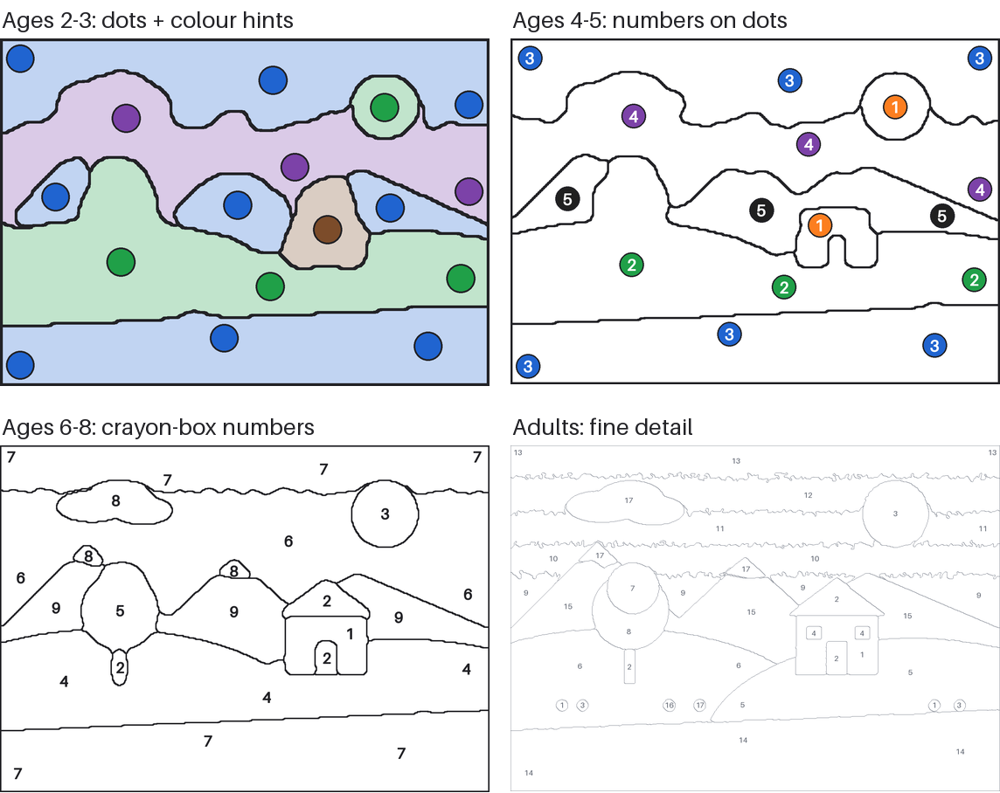
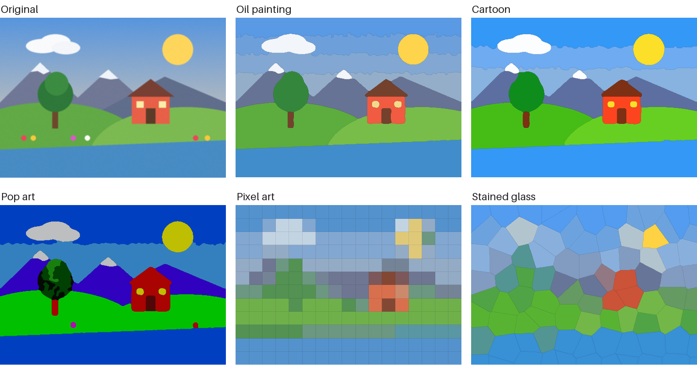

# Paint by Numbers

Turn any picture into a printable paint-by-numbers page, tuned to the age of
the painter: huge areas and colour dots for toddlers, numbered crayon-box pages
for school kids, and fine, many-coloured detail for adults. Optionally restyle
the picture first (oil painting, cartoon, pop art, pixel art, stained glass, ...).

The same Python engine runs as a **command-line tool** and as a **static web
app** that runs entirely in the browser through [Pyodide](https://pyodide.org/)
(no server, pictures never leave the device). Once GitHub Pages is enabled for
this repository, the app is served at
[saeed.im/paint_by_numbers](https://saeed.im/paint_by_numbers/), alongside
[Distribution Playground](https://github.com/saeedghsh/distribution_playground/)
and [Quiz Games](https://github.com/saeedghsh/quiz_games), whose layout this
project follows.

<p align="center"></p>

## Who is painting?

Pick an age group and every setting follows. You can still fine-tune each one.

| Profile | Ages | Colours | Smallest area (printed) | Marks in each area | Palette |
|---|---|---|---|---|---|
| Little hands | 2-3 | 4 | 30 mm, at most 9 areas | **colour dots + pale colour wash** (no numbers) | 8-crayon box |
| Preschool | 4-5 | 6 | 20 mm, at most 25 areas | **numbers on coloured dots** | 8-crayon box |
| Young painter | 6-8 | 10 | 11 mm, at most 70 areas | numbers | 16-crayon box |
| Big kid | 9-12 | 15 | 6 mm | numbers | from the picture |
| Teen | 13-17 | 22 | 4 mm | numbers | from the picture |
| Adult | 18+ | 30 | 2.8 mm | numbers | from the picture |
| Expert | 18+ | 40 | 1.8 mm | numbers | from the picture |

Lines get thinner, marks smaller and outlines softer (grey, easy to paint over)
as the painter gets older. For children who cannot read numbers yet there are
three alternatives:

- **Colour dots**: each area shows a dot of its colour - match the crayon to the dot.
- **Pale colour hints**: each area is washed in a light version of its colour.
- **Shapes**: circle, square, triangle, star, heart, ... with a shape-to-colour key.

The crayon palettes recolour the picture with crayons the child actually owns,
and the key uses plain names ("red", "light blue"). Each cluster of the picture
gets its own crayon where possible, so a brown cat still gets light, mid and
dark areas instead of one brown blob.

It also works the other way round: every page gets a **suggested age range**
based on its number of colours and areas, how small the areas are when printed,
and whether reading numbers is needed - for example *"Suggested for ages 6-8:
limited by 64 areas to paint"*. Background and age guidance are in
[how it works](docs/how_it_works.md).

## Styles

<p align="center"></p>

`photo`, `painterly` (oil painting), `cartoon`, `pop-art`, `watercolor`,
`pastel`, `vintage`, `pixel` (a numbered grid of squares) and `stained-glass`
(glass-like cells with lead lines).

## Outputs

- the **page** to paint (outlines + marks),
- the **finished look** (what it will look like when painted),
- a **colour key** (mark, swatch, name, hex code, share of the picture),
- a lossless, two-page **A4 PDF**: the page with its key, then the finished
  picture as an answer sheet.

## Setup with uv

Install [uv](https://docs.astral.sh/uv/getting-started/installation/), then:

```bash
uv sync --locked
```

The engine needs only NumPy and Pillow; Python 3.12 or newer is supported.

## Command line

```bash
uv run paint-by-numbers convert photo.jpg --age 6-8
uv run paint-by-numbers convert photo.jpg --age 3 -o pages/
uv run paint-by-numbers convert photo.jpg --age adult --style painterly --colors 24
uv run paint-by-numbers convert photo.jpg --age 5 --marker shapes --palette crayons-8
uv run paint-by-numbers presets      # list profiles, styles, palettes and marks
uv run paint-by-numbers sample       # write the built-in sample picture
```

`--age` takes a profile name or an age (`3`, `6-8`, `18+`). Every setting can be
overridden: `--colors`, `--min-size-mm`, `--max-regions`, `--smoothing`,
`--detail`, `--line-mm`, `--label-mm`, `--marker`, `--tint/--no-tint`,
`--palette`, `--style`, `--output-size`, `--seed`. Choose files with
`--outputs canvas,preview,legend,pdf,sheets,styled,json`.
`python -m paint_by_numbers` works too, and `make demo` converts the sample picture.

## Python

```python
from paint_by_numbers import Settings, generate, render

result = generate("photo.jpg", Settings.for_profile("6-8", style="cartoon"))
print(result.difficulty.summary())
pages = render(result)
pages.canvas.save("page.png")
open("print.pdf", "wb").write(pages.pdf())
```

## Browser app

```bash
make serve-pages
```

Open <http://localhost:8000>. The page loads Pyodide 0.28.3 (with its NumPy and
Pillow) from the jsDelivr CDN in a web worker, unpacks this package, and calls
it through a small JSON adapter. HTML and JavaScript only build the controls
(from a schema Python sends), forward choices and show the images Python draws;
no image processing is written in JavaScript. See
[browser architecture and deployment](docs/browser_architecture.md).

Without Make:

```bash
uv run python scripts/build_pages.py
uv run python -m http.server 8000 --directory _site
```

## Development

```bash
make test           # fast suite
make test-browser   # real browser + Pyodide (needs network access)
make code-quality   # black, mypy --strict, pylint
uv run python scripts/make_docs_images.py   # refresh the README pictures
```

## Ideas for later

- Paint-mixing hints (how to mix each colour from a basic paint set).
- Vector (SVG) output for very large prints.
- More marks for pre-readers (animals, letters).

## License

```
Copyright (C) Saeed Gholami Shahbandi
```

NOTE: This code/project was developed with the assistance of Claude, a product of Anthropic.

Distributed with a GNU GENERAL PUBLIC LICENSE; see [LICENSE](LICENSE).
